# Mlo (Dishi): System Overview for Diagramming

Source of truth: the code in `convex/` and `app/` as of 2026-11-24. Where the requirements
catalogue (`School Feeding Platform — Event Catalogue & Requirements.md`) and the code differ,
this file follows the **code** and lists the gaps in §12.

Each section maps to one or more diagram types:

| § | Content | Suggested diagram |
|---|---|---|
| 1 | Purpose and boundary | System context (C4 L1) |
| 2 | Actors | Actor list / use-case diagram |
| 3 | Use cases per actor | UML use-case diagram |
| 4 | Containers and external systems | Container / deployment diagram (C4 L2) |
| 5 | Internal components | Component diagram (C4 L3) |
| 6 | Data model | ERD / class diagram |
| 7 | Event catalogue (implemented) | Event map / pub-sub diagram |
| 8 | Core flows | Sequence diagrams / activity diagrams |
| 9 | State machines | UML state diagrams |
| 10 | Scheduled jobs and the daily timeline | Timeline / Gantt |
| 11 | Security and trust boundaries | Trust-boundary / DFD |
| 12 | Gaps vs the requirements catalogue | Notes |

---

## 1. Purpose and system boundary

Mlo is the **communication and reconciliation layer** of Nairobi's school feeding programme.
Food and money already move (county funds supplier → supplier cooks and delivers → pupil taps
an NFC tag for a KES 5 meal). Mlo records every meal and delivery as an **event**, then
tells the people who need to know: guardians (SMS/USSD), schools, suppliers, the county and
admins (live dashboards).

**Inside the boundary:** event ingest, rules engine, notification policy, SMS dispatch,
USSD menu, meal expectations and missed-meal detection, wallet mirror, delivery workflow,
forecasts, reconciliation, payment file, dashboards, admin console, retention.

**Outside the boundary:** the payment system (wallet balances are mirrored, not owned), the
SMS/USSD gateways, the vision model used to check delivery photos, the NFC hardware itself.

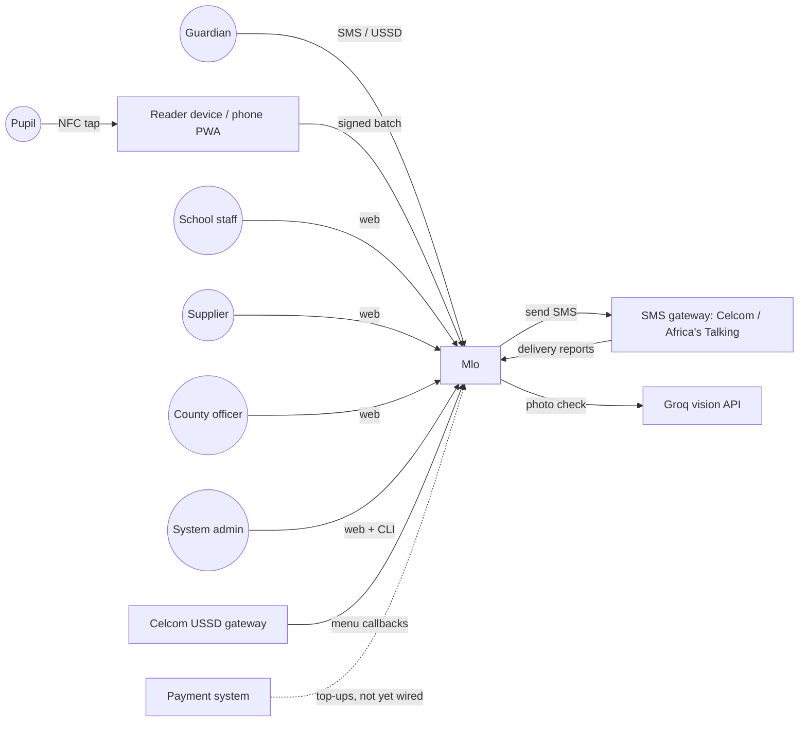

---

## 2. Actors

### 2.1 Human actors

| Actor | System role | Interface | What they care about |
|---|---|---|---|
| **Guardian** | none (no login; identified by phone number) | SMS (push), USSD `*265*39#` (pull) | Did my child eat? Is there money left? |
| **Pupil / student** | none | Taps an NFC tag at a reader | Gets a meal quickly; not singled out if balance is zero |
| **School staff** (head teacher, cook, patron) | `school` (scoped to one school) | Web workspace `/school/*`, phone reader `/reader` | Run service, override lost tags, confirm deliveries, manage roster and readers |
| **Supplier** (central kitchen) | `supplier` | Web workspace `/supplier/*`, operational SMS | Forecasts, declare dispatches, redeem receipt codes, reconciliation, forecast accuracy |
| **County programme officer** | `county` | Web workspace `/county/*` (+ can view school and supplier views) | Variance and integrity exceptions per school, payment file |
| **System administrator** | `admin` (sees every workspace) | Web `/admin/*` + Convex CLI | Rules, settings, devices, deliverability, delivery dispute resolution, role assignment |

Role → workspaces visible (`app/components/Workspace.tsx`):

| Role | school | supplier | county | admin |
|---|---|---|---|---|
| school | ✓ (own school only) | | | |
| supplier | | ✓ | | |
| county | ✓ (any school) | ✓ | ✓ | |
| admin | ✓ | ✓ | ✓ | ✓ |

New sign-ups are created as `school` users attached to the pilot school `NRB-PILOT-01`.
An admin promotes them with `npx convex run users:assignRole`.

### 2.2 System and external actors

| Actor | Type | Interaction |
|---|---|---|
| **NFC reader / phone reader PWA** | Device | Queues taps offline in `localStorage`, posts HMAC-signed batches to `POST /ingest` |
| **Service-day simulator** | Internal action | Acts as a registered reader and posts real signed batches (demo/testing) |
| **Scheduler / crons** | Time | Starts service days, sweeps, forecasts, reconciliation, digest, reader checks, retention |
| **SMS gateway** (Celcom, Africa's Talking, or `console` stub) | External | Receives outbound SMS; calls back `POST /dlr?token=` with delivery reports |
| **USSD gateway** (Celcom) | External | Calls `GET /ussd/<token>` on each menu step |
| **Groq vision API** (`qwen/qwen3.8-27b`) | External AI | Assesses delivery receipt photos (food visible, clarity, unrelated content) |
| **Payment system** | External (planned) | Would call `POST /wallet?token=`; route is commented out, top-ups currently run via `wallets:applyPayment` from the CLI |
| **Better Auth** | Embedded component | Email + password sign-in; sessions for web users |

---

## 3. Use cases per actor

**Guardian**
- Receive SMS: meal eaten, meal served by override, meal missed, top-up received, low balance,
  balance depleted, depletion forecast, weekly digest
- USSD: 1 status today · 2 balance · 3 last 5 meals · 4 toggle notification types · 5 change phone number
- Messages arrive in their language (`en` / `sw`), respect quiet hours, a daily cap, and are
  merged when several fire within the collapse window

**Pupil**
- Tap tag → meal recorded (second tap same day is rejected as duplicate, no second debit)
- Served by staff override when the tag is lost, forgotten, damaged, or the reader is down

**School staff**
- Run meal service: live served-vs-expected count, roster, override panel, reader health
- Provision a phone as a reader (`readers:provision` → device ref + signing key shown once)
- Assign / reissue NFC tags; deactivate or add pupils (roster corrections)
- Import enrolment from a PDF roster (upload → parse → review → commit)
- Receive deliveries: record portions received with a photo, or request a one-time code
  when no photo is possible; report problems (→ dispute)
- See forecasts, override rate, guardian communications, delivery inbox
- Operations tools: run expectations / sweep / forecast / reconciliation on demand, simulator

**Supplier**
- See tomorrow's forecast per school
- Declare a dispatch (school, portions, vehicle, docket ref)
- Redeem the school's one-time receipt code
- Reconciliation per school per day (dispatched / confirmed / consumed / variance)
- Forecast accuracy for the trailing period
- Receive operational SMS / inbox items (escalations)

**County officer**
- Overview: schools ranked by variance, variance streaks, override rates, meals served,
  guardians reached, deliverability %
- Drill into school events
- Download payment file (CSV) built only from confirmed deliveries

**System admin**
- Edit rules (event type, JSON predicate, en/sw templates, priority, enable/disable)
- Dry-run replay a rule against past events before enabling it
- Change runtime settings (windows, caps, thresholds, SMS channel, retention…)
- Device fleet health; revoke a device
- Communications and SMS spend
- Resolve delivery reviews and disputes; declare dispatch on behalf of the pilot supplier
- Assign roles (CLI)

---

## 4. Containers and deployment

| Container | Tech | Hosts |
|---|---|---|
| **Web app** | Next.js 16 (App Router), React 19, Tailwind 4, deployed with OpenNext on **Cloudflare Workers** at `mlo.2003.studio` | Landing, login, role workspaces, `/reader` PWA, `/api/auth/*` proxy |
| **Convex backend** | Convex cloud deployment | Database, queries/mutations/actions, scheduler, crons, file storage, HTTP routes (`*.convex.site`) |
| **Convex components** | `@convex-dev/better-auth`, `@convex-dev/rate-limiter` | Auth tables and sessions; receipt-code attempt limiting |
| **Phone reader** | Chrome on NFC-capable Android, Web NFC (`NDEFReader`) | Reads tag serial, queues taps, signs and posts batches |
| **External** | Celcom / Africa's Talking SMS, Celcom USSD, Groq API | Messaging, USSD, photo assessment |

HTTP routes on Convex (`convex/http.ts`):

| Route | Caller | Auth |
|---|---|---|
| `POST /ingest` | Reader / simulator | `X-Device-Ref` + `X-Signature` (HMAC-SHA256 of the body with the device secret), revoked devices refused |
| `POST /dlr?token=` | SMS gateway | Shared `DLR_TOKEN` |
| `GET /ussd/<token>` | USSD gateway | Shared `USSD_TOKEN` in path |
| `POST/GET /delivery-photo` | School web app | Better Auth bearer token, delivery access check |
| `/api/auth/*` | Browser | Better Auth |
| `POST /wallet?token=` | Payment system | **Not active** (commented out) |

Browser ↔ Convex: reactive queries and mutations over WebSocket; every public function calls
`requireUser` / `requireRole` / `requireSchoolScope`.

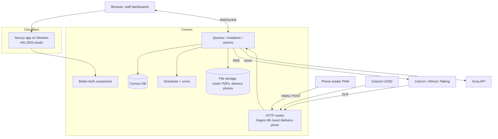

---

## 5. Internal components (backend)

| Component | Files | Responsibility |
|---|---|---|
| Ingest | `ingest.ts`, `http.ts` | Verify device, dedupe by `eventId`, resolve tag → pupil, emit `meal.tapped` / `meal.duplicate_rejected`, fulfil expectation, debit wallet |
| Event log | `lib/events.ts` (`recordEvent`) | Append to `events`; schedule `rules.evaluate` **in the same transaction** |
| Rules engine | `rules.ts`, `lib/predicate.ts`, `lib/template.ts` | Match enabled rules by event type, evaluate JSON predicate, resolve guardians, render localised template |
| Notification policy | `lib/policy.ts` | Opt-out → collapse/merge → daily cap → quiet hours/defer |
| Channels (adapter) | `channels.ts`, `lib/channels/*` | `SmsChannel` interface; `console`, `celcom`, `africastalking` chosen by the `smsChannel` setting |
| Notifications | `notifications.ts`, `lib/retry.ts` | Mark sent/failed, retry transient failures with backoff, apply DLRs |
| Expectations | `expectations.ts` | Materialise one expectation per active pupil per school day; sweep at cutoff → `meal.missed` |
| Service monitor | `monitor.ts` | Mid-window run-rate check → `service.stalled` |
| Overrides | `overrides.ts` | Staff-served meal with reason code; override rate |
| Wallets | `wallets.ts`, `lib/wallet/*` | Debit per meal, top-up, low-balance hysteresis, depletion forecast |
| Readers / devices | `readers.ts`, `devices.ts` | Provision phone readers, assign tags, fleet health, silent-reader flag |
| Roster / enrolment | `roster.ts`, `enrolment.ts`, `enrolment/parsePdf.ts`, `lib/enrolmentParser.ts` | Join/deactivate pupils; PDF roster import |
| Deliveries (v1, legacy) | `deliveries.ts` | Declare with confirm code, resolve, unconfirmed sweep |
| Delivery workflow (v2) | `deliveryWorkflow.ts`, `lib/deliveryWorkflow.ts`, `deliveryPhotos.ts`, `deliveryAssessment.ts`, `deliveryNotifications.ts`, `deliveryDashboard.ts` | Dispatch, photo or code receipt, AI photo check, overdue escalation, admin resolution, delivery inbox + operational SMS |
| Forecast & reconciliation | `deliveries.ts`, `lib/supply.ts` | Next-day portion forecast; daily dispatched/confirmed/consumed variance; payment file |
| County integrity | `county.ts` | Variance streaks, override-rate breach, county overview |
| Supplier views | `supplier.ts` | Supplier overview and accuracy |
| USSD | `ussd.ts`, `lib/ussd.ts` | Stateless menu over cumulative input; opt-out toggles; number change |
| Digest | `digest.ts` | Weekly per-guardian summary event |
| Admin | `admin.ts` | Rules CRUD, settings, device revoke, metrics, dry-run replay, deliverability |
| Retention | `retention.ts` | Purge old events/notifications, de-identify deactivated pupils |
| Settings | `settings.ts` | Runtime-tunable key/value config |
| Simulator | `simulator.ts`, `lib/simulation.ts` | Generates a realistic service day through the real `/ingest` |
| Auth & authz | `auth.ts`, `users.ts`, `lib/authz.ts`, `lib/roles.ts` | Better Auth; profile bootstrap; role and school-scope checks |
| Privacy helpers | `lib/mask.ts`, `lib/hmac.ts` | Mask phone numbers/names in logs; HMAC and SHA-256 |

---

## 6. Data model

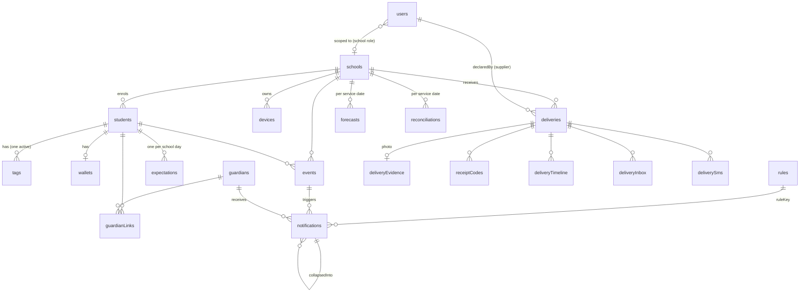

| Table | Key fields | Notes |
|---|---|---|
| `users` | authUserId, displayName, role, schoolId? | Profile linked to a Better Auth user |
| `schools` | code, name, active | Pilot: `NRB-PILOT-01` |
| `students` | schoolId, studentRef, fullName, className, status | `active` / `deactivated` |
| `guardians` | msisdn, displayName, language, optedOutTypes[], consent | No login |
| `guardianLinks` | guardianId, studentId, relationship, active | Many-to-many |
| `tags` | tagUid, studentId, status | `active` / `revoked` |
| `devices` | deviceRef, schoolId, secretHash, firmwareVersion, lastSeenAt, revokedAt | Readers |
| `academicCalendar` | serviceDate, isSchoolDay, dayType | full / half / exam / holiday |
| `events` | eventId (unique), type, occurredAt, recordedAt, correlationId, payload, schoolId?, studentId?, serviceDate? | **Append-only** event log; also the audit log (`admin.*`) |
| `expectations` | schoolId, studentId, serviceDate, windowStart, windowEnd, cutoffAt, status | Makes "no tap" observable |
| `wallets` | studentId, balanceKes, lowBalanceArmed | Mirror of the payer's balance |
| `rules` | key, eventType, predicate (JSON), audience=`guardian`, templates {en,sw}, priority, enabled | Behaviour as data |
| `notifications` | dedupeKey, ruleKey, eventId, guardianId, msisdn, body, segments, status, suppressionReason, deliverAt, collapsedInto, providerMessageId, attempts | Guardian SMS |
| `deliveries` | schoolId, serviceDate, portions, vehicle, docketRef, declaredBy, status, portionsReceived, receiptMethod, reviewRequired, photoReview, workflowVersion… | Supply chain |
| `deliveryEvidence` | deliveryId, storageId, contentType, size | Receipt photo |
| `receiptCodes` | deliveryId, hash, expiresAt, failures, cooldownUntil | One-time code fallback |
| `deliveryTimeline` | deliveryId, type, actorId, detail | Per-delivery history |
| `deliveryInbox` | recipientKey, deliveryId, body, readAt | In-app operational messages |
| `deliverySms` / `operationalContacts` | recipientKey, msisdn, status | Operational SMS to school/supplier/admin contacts |
| `forecasts` | schoolId, serviceDate, portions, confidence | Next-day demand |
| `reconciliations` | schoolId, serviceDate, dispatched, confirmed, received, consumed, variance, variancePct | Daily cross-stream join |
| `settings` | key, value, description | Runtime config |

---

## 7. Event catalogue (as implemented)

All events go through `recordEvent`, which writes to `events` and schedules `rules.evaluate`.
Only events with an enabled rule produce guardian SMS; the rest feed dashboards, audit and
analytics.

| Event | Emitted by | Trigger class | Guardian SMS rule |
|---|---|---|---|
| `meal.tapped` | Ingest | Event | `guardian.meal_tapped` |
| `meal.duplicate_rejected` | Ingest | Event | — |
| `meal.override_served` | School staff (overrides) | Event | `guardian.meal_override_served` |
| `meal.expectation_created` | Service-day start | Schedule | — |
| `meal.missed` | Cutoff sweep | **Absence** | `guardian.meal_missed` |
| `service.stalled` | Mid-window monitor | Window | — (dashboards) |
| `wallet.debited` | Meal debit | Event | — |
| `wallet.topped_up` | Payment (`applyPayment`) | Event | `guardian.wallet_topped_up` |
| `wallet.low_balance` | Balance comparator | **Threshold** (hysteresis) | `guardian.wallet_low_balance` |
| `wallet.depleted` | Balance comparator | Threshold | `guardian.wallet_depleted` |
| `wallet.depletion_forecast` | Burn-rate projection | **Predictive** | `guardian.wallet_depletion_forecast` |
| `digest.weekly` | Friday cron | Schedule | `guardian.weekly_digest` |
| `student.enrolled` | Roster import | Event | — |
| `student.tag_assigned` | School (readers) | Event | — |
| `student.deactivated` | School (roster) | Event | — |
| `guardian.preferences_updated` | Guardian via USSD | Event | — |
| `guardian.contact_updated` | Guardian via USSD | Event | — |
| `delivery.dispatched` / `confirmed` / `disputed` | Legacy v1 delivery flow | Event | — |
| `delivery.unconfirmed` | Legacy v1 sweep | Absence | — |
| `demand.forecast_published` | Nightly forecast | Schedule | — |
| `reconciliation.daily_computed` | Daily reconciliation | Schedule | — |
| `reconciliation.variance_exceeded` | Integrity check | **Reconciliation** | — (county) |
| `integrity.override_rate_exceeded` | Integrity check | Window | — (county) |
| `device.heartbeat_missed` | Pre-service reader check | Absence | — |
| `notification.suppressed` | Rules/policy | Event | — |
| `notification.delivered` / `notification.failed` | DLR webhook | Event | — |
| `admin.rule_changed`, `admin.rule_toggled`, `admin.setting_changed`, `admin.device_revoked`, `admin.device_reprovisioned` | Admin console | Audit | — (never purged) |

The v2 delivery workflow records its history in `deliveryTimeline` (`dispatched`,
`receipt.confirmed`, `receipt.disputed`, `receipt.code_rejected`, `photo.clear|flagged|failed`,
overdue, resolved…), not in `events`.

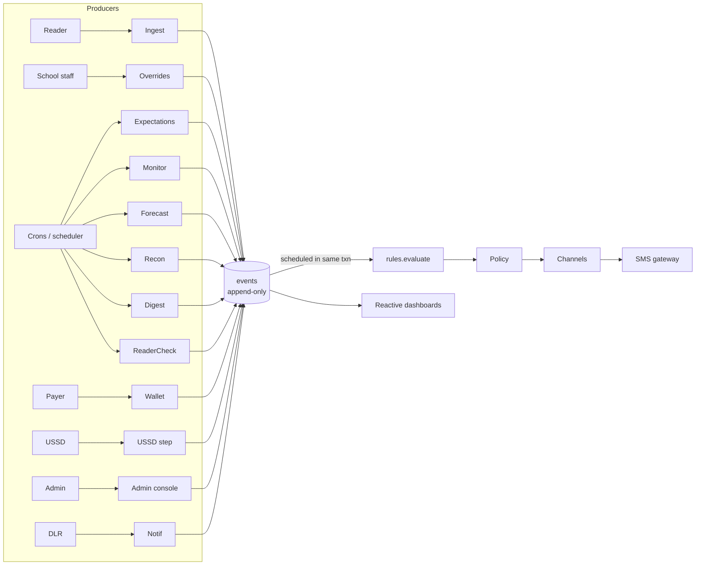

---

## 8. Core flows

### 8.1 Reader setup (school staff)

1. Staff signs in, opens `/school/readers` or `/reader`.
2. `readers:provision(schoolId)` creates a `devices` row with a random `PHONE-xxxxxxxx`
   ref; the signing key is returned **once**, only its hash is stored.
3. The PWA saves `{deviceRef, signingKeyHex}` in `localStorage`.
4. Staff assigns tags: tap a blank tag → `readers:assignTag` → `tags` row
   (an old active tag is revoked as `reassigned`) → `student.tag_assigned`.

### 8.2 Meal tap → guardian SMS (the main flow)

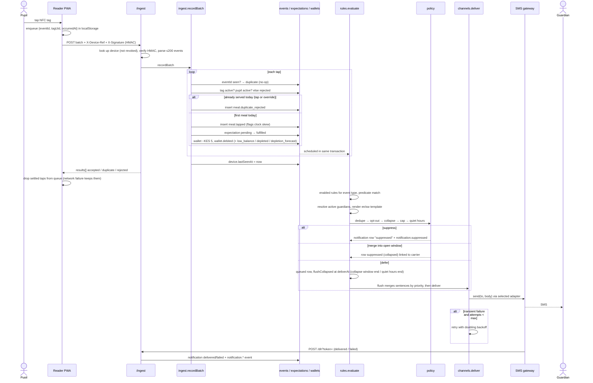

Key properties: device-generated `eventId` makes replays a no-op; one countable meal per pupil
per day; event write and rule scheduling commit atomically; zero-balance pupils are still
served (the wallet mirror may go negative).

### 8.3 Notification policy (activity)

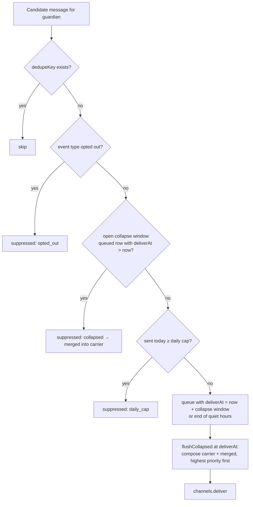

Default settings: collapse 10 min, daily cap 3, quiet hours 21:00–06:00 Nairobi.

### 8.4 Service day: expectations, stalled check, missed-meal sweep

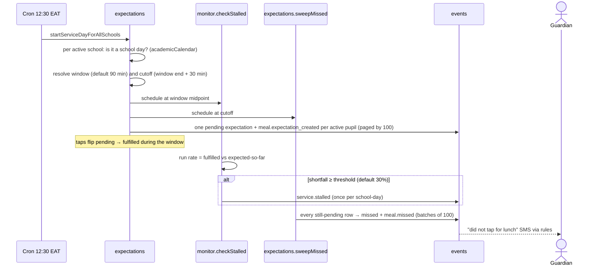

A tap after the sweep is still recorded, but the expectation stays `missed`.

### 8.5 Manual override (lost / forgotten / damaged tag, reader down)

Staff picks pupil + reason in `/school/service` → `overrides:serve` → checks pupil is active and
in the school → if not already served today: `meal.override_served` (with `staff_id`),
expectation fulfilled, wallet debited → guardian receives the same "had lunch" SMS. Override
rate (overrides ÷ meals, 14-day lookback) shows to the school and feeds county integrity.

### 8.6 Wallet

- **Debit:** every counted meal debits `mealPriceKes` (default 5). No wallet row → served and recorded, no debit.
- **Top-up:** `wallets:applyPayment({schoolCode, studentRef, amountKes | newBalanceKes, externalRef})`,
  idempotent on `externalRef` → `wallet.topped_up`. Today this is run from the CLI (mock payer).
- **Threshold with hysteresis:** crossing below `lowBalanceThresholdKes` emits `wallet.low_balance`
  once and disarms; re-arms only above threshold + margin. Reaching zero emits `wallet.depleted`.
- **Predictive:** projects the depletion date over upcoming school days; emits
  `wallet.depletion_forecast` once per (pupil, projected date) when it is within the lead days.

### 8.7 Guardian USSD session

```mermaid
sequenceDiagram
  actor Guardian
  participant GW as Celcom USSD
  participant HTTP as /ussd/{token}
  participant U as ussd.step
  Guardian->>GW: dial *265*39#
  GW->>HTTP: GET SESSIONID, MSISDN, INPUT="" 
  HTTP->>U: step(inputs=[])
  U->>U: find guardian by MSISDN variants (+254 / 254 / 07)
  U-->>Guardian: CON main menu (en/sw)
  Guardian->>GW: 1 / 2 / 3 / 4 / 5
  GW->>HTTP: INPUT cumulative "4*2"
  HTTP->>U: replay the path
  alt 1 Status today / 2 Balance / 3 Last 5 meals
    U-->>Guardian: END answer (per child; asks "which child?" if several)
  else 4 Notifications
    U->>U: toggle opt-out for chosen type → guardian.preferences_updated
  else 5 Change number
    U->>U: validate Kenyan mobile, confirm → update msisdn → guardian.contact_updated
  end
```

Unknown numbers get "not registered, ask your school". Screens are capped at 182 chars.

### 8.8 Delivery workflow v2 (current)

```mermaid
sequenceDiagram
  actor Supplier
  actor School as School staff
  participant WF as deliveryWorkflow
  participant Photo as /delivery-photo
  participant AI as deliveryAssessment (Groq)
  participant N as deliveryNotifications
  actor Admin

  Supplier->>WF: dispatch(school, portions, vehicle, docket, requestId)
  WF->>WF: idempotent on requestKey + fingerprint; status declared; ref DLV-…
  WF->>N: inbox + SMS to school contacts "N portions incoming, expected by HH:MM"
  WF->>WF: schedule markOverdue at +30 min
  alt receipt with photo
    School->>Photo: upload JPEG/PNG ≤10 MB (bearer token)
    School->>WF: submitReceipt(portionsReceived, problem?)
    WF->>WF: confirmed if portions match and no problem, else disputed (+ review)
    WF->>AI: assess photo
    AI->>AI: Groq vision → foodVisible / clarity / unrelatedContent
    AI->>WF: photoReview clear | flagged | failed (flagged/failed → review required)
  else no photo possible
    School->>WF: requestCode(portionsReceived, problem?) → one-time code (30 min)
    School-->>Supplier: reads code to driver
    Supplier->>WF: redeemCode(code) (5 failures per window, then cooldown)
    WF->>WF: confirmed / disputed, review required
  end
  WF->>WF: schedule reconciliation for the school-day
  opt nobody records receipt by +30 min
    WF->>WF: markOverdue → unconfirmed, review required
    WF->>N: escalate to school + supplier + admin
  end
  Admin->>WF: resolve(confirm | dispute | reviewed, reason)
```

The legacy v1 flow (`deliveries:declare` / `deliveries:resolve`) still exists: the supplier gets a
confirm code at declaration, the school enters it to confirm or dispute, and a sweep at
`expectedConfirmBy` emits `delivery.unconfirmed`. Its events are the `delivery.*` rows in §7.

### 8.9 Forecast → reconciliation → payment file

1. **21:00 EAT nightly:** for each active school, if tomorrow is a school day, compute portions
   and confidence from active pupils and trailing fulfilled/expected history → `forecasts` row,
   `demand.forecast_published` on first publication. Supplier and school dashboards show it.
2. **18:00 EAT daily** (and after each v2 receipt): page over fulfilled expectations for
   *consumed*, join with the day's deliveries for *dispatched / confirmed / received*, compute
   variance (confirmed − consumed) → `reconciliations` row, `reconciliation.daily_computed`.
3. **Integrity check** right after: variance beyond tolerance for N consecutive days →
   `reconciliation.variance_exceeded`; override rate above tolerance →
   `integrity.override_rate_exceeded` (each at most once per school-day).
4. **Payment file** (county/admin): one line per **confirmed** delivery:
   schoolCode, serviceDate, docketRef, portionsConfirmed × `supplierPortionRateKes` → CSV.
   No declaration and confirmation, no line.

### 8.10 Enrolment (PDF roster import)

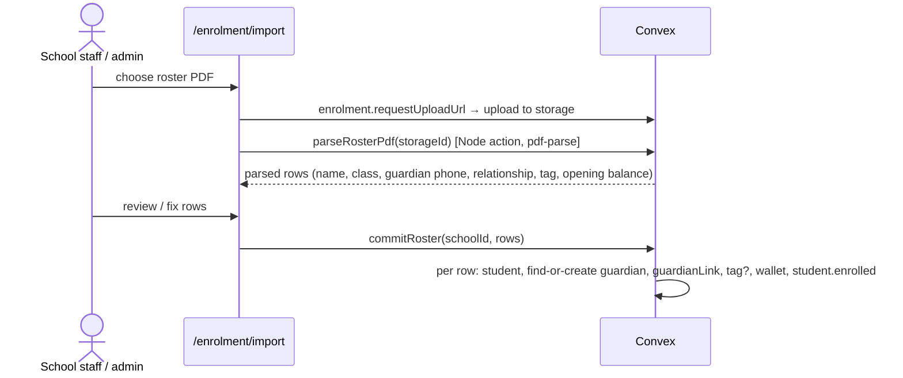

Roster corrections: `roster:join` adds a pupil; `roster:deactivate` emits `student.deactivated`
and removes them from the next day's expectations and forecast.

### 8.11 Staff sign-in and onboarding

Email + password via Better Auth → `users:bootstrapProfile` creates a `school` profile on the
pilot school → admin runs `users:assignRole` for supplier / county / admin → the workspace shell
shows the workspaces allowed by role. Every backend function re-checks role and school scope.

### 8.12 Admin: change a rule safely

Admin opens `/admin/rules` → edits predicate/templates → `dryRunReplay` replays the rule over
recent events and reports matches and SMS cost (segments × cost per segment) → `upsertRule`
(`templateVersion`++) → `admin.rule_changed` audit event → takes effect on the next event,
no deploy. `setRuleEnabled`, `setSetting` and `revokeDevice` are audited the same way.
Revoked devices fail the `/ingest` signature lookup immediately.

### 8.13 Deliverability

`admin:deliverability` and
`admin:metrics` give delivered %, failures by reason, spend per rule, NFR timings.

### 8.14 Weekly digest

Friday 15:00 EAT: per guardian, one line per linked active pupil:
"<first name> <taken>/<possible> meals, KES <balance>" → `digest.weekly` event addressed to the
guardian → `guardian.weekly_digest` rule → normal policy and SMS path.

### 8.15 Silent reader check

12:00 EAT: any device that has synced before but not within `readerSilentHours` (default 20 h)
→ `device.heartbeat_missed` (once per device per day) → school reader-health panel and admin
fleet view.

### 8.16 Retention

02:00 EAT: delete `events` older than `retentionEventDays` (except `admin.*` audit events) and
`notifications` older than `retentionNotificationDays`; de-identify pupils deactivated longer
than `retentionStudentDays` (name → "Student <ref>", guardian links deleted). Batches chain until
done.

### 8.17 Simulator (demo)

School "Operations tools" → `simulator:runServiceDay(schoolId, serviceDate, seed, noShowCount,
batchSize)` → registers `SIM-READER-01` with a real secret → plans taps across the window
(no-show cohort for the missed path; large `batchSize` imitates an offline reader flushing) →
posts signed batches to the real `/ingest`.

---

## 9. State machines

**Expectation**
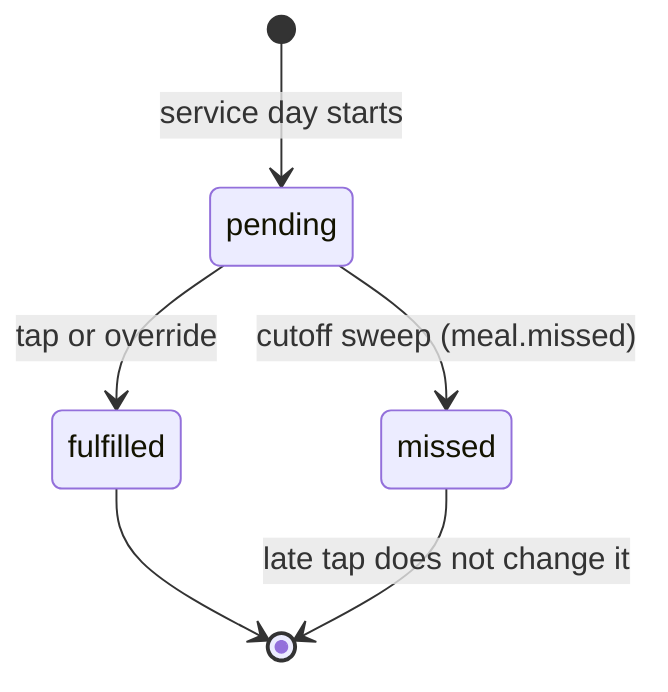

**Guardian notification**
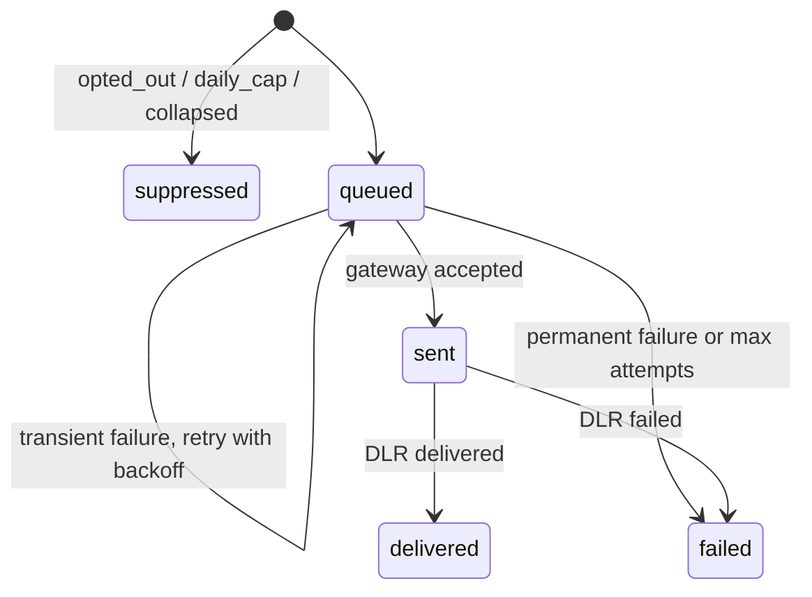

**Delivery (v2)**
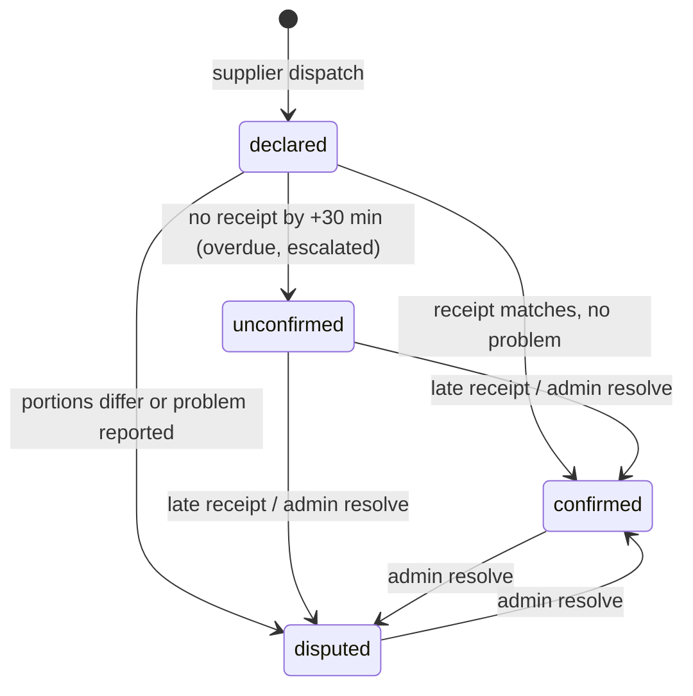
Parallel flag `reviewRequired` is set for disputes, code receipts, missing evidence, flagged or
failed photos, and overdue deliveries; cleared by admin resolution.

**Delivery photo review**
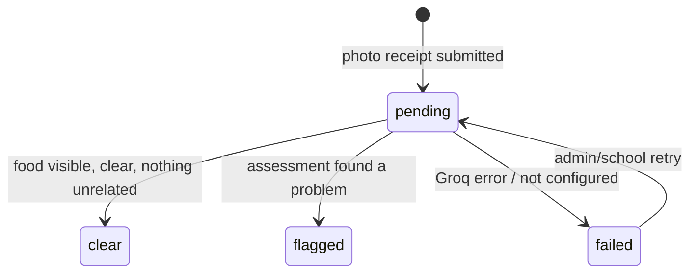

**Low-balance alert (hysteresis)**
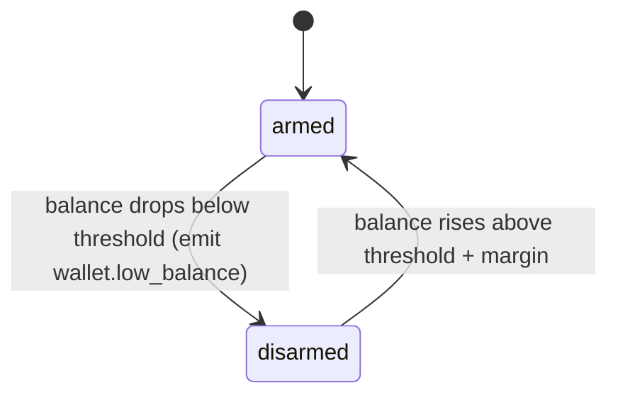

**Tag:** `active` → `revoked` (reassigned / lost). **Pupil:** `active` → `deactivated` → (after
retention) de-identified. **Device:** provisioned → seen (`lastSeenAt`) → silent (flag) → revoked.

---

## 10. Scheduled jobs and the daily timeline (Africa/Nairobi, UTC+3)

| Time (EAT) | Job | Output |
|---|---|---|
| 02:00 | Retention purge | Deleted events/notifications, de-identified pupils |
| 12:00 | Flag silent readers | `device.heartbeat_missed` |
| 12:30 | Start service day (all schools) | Expectations, schedules stalled check + sweep |
| ~13:15 (window midpoint) | Stalled-service check (scheduled) | `service.stalled` |
| 12:30–14:00 | Service window (default 90 min) | Taps, overrides, guardian SMS |
| ~14:30 (cutoff) | Missed-meal sweep (scheduled) | `meal.missed` → guardian SMS |
| any time | Delivery dispatched → +30 min overdue check (scheduled) | Escalation |
| 18:00 | Daily reconciliation + integrity flags | `reconciliation.*`, `integrity.*` |
| 21:00 | Tomorrow's forecast | `demand.forecast_published` |
| Fri 15:00 | Weekly guardian digest | `digest.weekly` → SMS |
| 21:00–06:00 | Quiet hours | Guardian SMS deferred to 06:00 |

All windows, cutoffs, caps and thresholds are rows in `settings` and can be changed at runtime.

```mermaid
gantt
  dateFormat HH:mm
  axisFormat %H:%M
  section Platform
  Retention purge        :02:00, 15m
  Reader check           :12:00, 10m
  Reconciliation         :18:00, 15m
  Forecast               :21:00, 15m
  section Service
  Service window         :12:30, 90m
  Stalled check          :13:15, 5m
  Grace to cutoff        :14:00, 30m
  Missed sweep           :14:30, 5m
  section Guardian
  Quiet hours (evening)  :21:00, 179m
```

---

## 11. Security and trust boundaries

| Boundary | Control |
|---|---|
| Reader → `/ingest` | Per-device secret (hash only stored), HMAC-SHA256 over raw body, timing-safe compare, revocation check, max 200 events, strict body narrowing |
| Replays | Unique `eventId`; second meal same day rejected; `requestKey` + fingerprint on delivery operations |
| Gateways → `/dlr`, `/ussd` | Shared secret tokens (`DLR_TOKEN`, `USSD_TOKEN`), timing-safe compare |
| Browser → Convex | Better Auth session; `requireRole` / `requireSchoolScope` on every public function; school users limited to their own school |
| Delivery access | School of the delivery, the declaring supplier, admin (and county for read) |
| Receipt codes | Hashed, 30-min expiry, rate limited (5 failures per window, then 15-min cooldown) |
| Photos | Auth bearer token, type sniffed from bytes (JPEG/PNG), 10 MB limit |
| PII | Phone numbers and names masked in logs (`lib/mask.ts`); retention purge and de-identification |
| Audit | `admin.*` events in the append-only log, excluded from purge |
| Secrets | Convex env vars only (`BETTER_AUTH_SECRET`, gateway keys, tokens, `GROQ_API_KEY`) |

---

## 12. Gaps versus the requirements catalogue

Useful when a diagram should show the **target** design rather than the current build.

| Catalogue item | Status in code |
|---|---|
| Payment gateway callback `POST /wallet` | Commented out; top-ups via CLI `wallets:applyPayment` |
| WhatsApp channel for suppliers | Not built; suppliers use web + operational SMS |
| Supplier / county / school alerts as **rules** | Rules audience is `guardian` only; `service.stalled`, `reconciliation.variance_exceeded`, `integrity.*`, `device.heartbeat_missed` surface on dashboards. Delivery alerts use the separate `deliveryInbox` + `deliverySms` path |
| `meal.tap_anomaly_detected`, `welfare.consecutive_misses`, `delivery.shortfall_detected` | Not implemented |
| `device.sync_completed`, `device.clock_skew_detected` | Not separate events; `lastSeenAt` is updated and skew is a `clock_skew_flagged` flag in the `meal.tapped` payload |
| `student.tag_revoked`, `guardian.linked` | No dedicated events (tags revoked on reassignment; links created during enrolment) |
| `notification.queued` / `notification.sent` | Tracked as `notifications` row status, not events |
| v2 delivery events | v2 workflow writes `deliveryTimeline`, not `delivery.*` events |
| Staff tag confirmation of deliveries | Replaced by photo or one-time code |
| Multi-school onboarding | Sign-ups attach to the single pilot school; roles assigned by CLI |
